<a href="https://bnramadan.com"></a>



<b>🗝️ Open the achievement log</b>

 

| Achievement | How it was earned |
|---|---|
| **Arabic-first** | Right-to-left layouts designed as layouts, and a portfolio in 17+ languages. |
| **Core Web Vitals** | A performance budget set before design, and a release gate that blocks a slow page. |
| **Grounded AI** | Assistants that answer from the client's own data, with a person approving what matters. |
| **Secure by default** | Every request re-checked on the server, every input treated as untrusted. |
| **(+MVP)** | Products that can sell from version one: groundwork first, no bloat, no delay for harmless flaws. |

<b>Choose your quest</b>

<a href="https://bnramadan.com">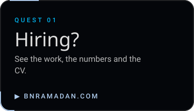</a>
<a href="mailto:contact@bnramadan.com">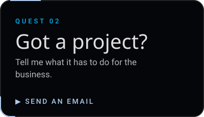</a>
<a href="#stack">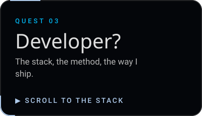</a>

I'm Mohamed, a full-stack engineer based in Egypt. For more than five years I have shipped production work for clients in six countries. I came to code from marketing, so I judge a website by what it does for the business: how fast it opens, whether people and search engines can find it, and whether visitors act on it. I build with Next.js, TypeScript and MongoDB, ship Arabic-first when the audience is, and treat motion as part of the product rather than decoration.

### What I build

- **Fast by budget, not by luck.** Core Web Vitals are a release gate, not a report written after launch.
- **Found by people and by AI assistants.** Technical SEO, structured data and answer-engine readiness, so the work can be found, understood and cited.
- **AI features that stay grounded.** Assistants that answer from the client's own data, with a person approving anything that matters.
- **Arabic-first and multilingual.** Right-to-left layouts designed as layouts, not mirrored at the end. My own portfolio runs in more than 17 languages.
- **Secure by default.** Every request is re-checked on the server, and every input is treated as untrusted.
- **Motion that is engineered.** GSAP and Three.js, tuned so the animation never spends the performance budget.

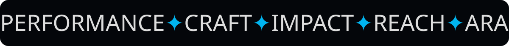

### Worlds unlocked


**Egypt** (13): [Fall In Scent](https://bnramadan.com/en/projects/fallin-scent), [Khaled Mo](https://bnramadan.com/en/projects/khaled-mo), [Hosavity](https://bnramadan.com/en/projects/hosavity), [Yoka Canvas](https://bnramadan.com/en/projects/yokacanvas), [Jockey MM Kids](https://bnramadan.com/en/projects/jockey-mm-kids), [Baly Leather](https://bnramadan.com/en/projects/balyleather), [BnRamadan Portfolio](https://bnramadan.com/en/projects/bnramadan-portfolio), [Thermo Egypt](https://bnramadan.com/en/projects/thermo-egypt), [Vllol](https://bnramadan.com/en/projects/vllol-portfolio), [Heba Abd El-Razek](https://bnramadan.com/en/projects/heba-abd-el-razek), [BnRamadan Store](https://bnramadan.com/en/projects/bnramadan-store), [MS NFSA](https://bnramadan.com/en/projects/msnfsa), [SG SOC Analyst](https://bnramadan.com/en/projects/sg-soc-analyst)

**Saudi Arabia** (1): [Tawazun](https://bnramadan.com/en/projects/tawazun)

**Germany** (1): [FAW4U](https://bnramadan.com/en/projects/faw4u)

**Japan** (1): [Yoi Cosmetics](https://bnramadan.com/en/projects/yoi-cosmetics)

**New Zealand** (1): [Wild Valley Honey](https://bnramadan.com/en/projects/wild-valley-honey)

**USA** (1): [Pr - One Piece](https://bnramadan.com/en/projects/one-piece-slider)

**[▶ Fly the interactive map](https://github.com/BnRamadan/BnRamadan/blob/main/worlds.geojson)**: drag, zoom and open each country.

Each project opens its case page on bnramadan.com. Much of the client work lives in private repositories.

### Play

<a href="https://github.com/BnRamadan/BnRamadan/blob/main/game/README.md">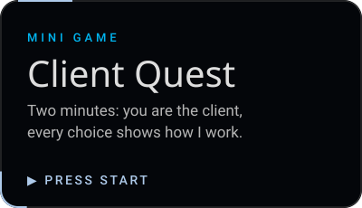</a>
<a href="https://github.com/BnRamadan/BnRamadan/blob/main/assets/bn.stl">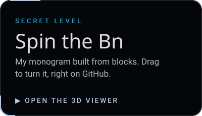</a>

**Client Quest** is a two-minute choose-your-path game: you are the client, and every choice shows how I work. The **secret level** is a 3D model of my monogram, built from blocks, that you can turn with your mouse. Nothing to install, nothing to sign in to.

### How I work

I build to sell from version one. The legal and operational groundwork comes before the first line of code, nothing gets built that the launch does not need, and a visible but harmless flaw never delays a launch that is otherwise ready. I call it **(+MVP)**.

### Stack


### Daily run

<picture>
  <source media="(prefers-color-scheme: dark)" srcset="https://raw.githubusercontent.com/BnRamadan/BnRamadan/output/snake-dark.svg">
  
</picture>

### Get in touch

[bnramadan.com](https://bnramadan.com) &nbsp;·&nbsp; [contact@bnramadan.com](mailto:contact@bnramadan.com)

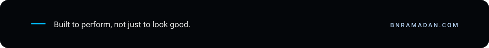
