**What do you do?**

- **[Ship it within the budget](06-shipped.md)**
- **[Add a heavy hero video first](05-trap.md)**

[Restart](README.md) &nbsp;·&nbsp; [Back to the profile](https://github.com/BnRamadan)
