**What do you do?**

- **[Launch the version that can sell](06-shipped.md)**
- **[Build every feature first](05-trap.md)**

[Restart](README.md) &nbsp;·&nbsp; [Back to the profile](https://github.com/BnRamadan)
